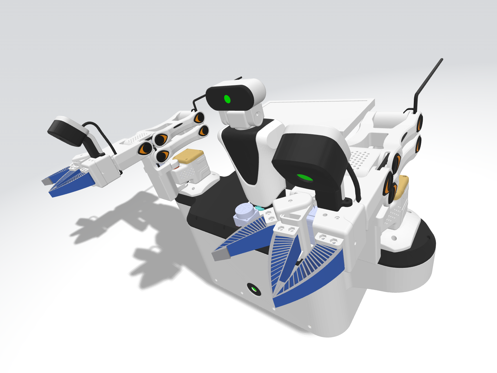

# adora_nano_description



*ADORA NANO — 3-wheel mobile base, pan-tilt camera head, two 5-DOF arms, two-blade soft grippers.*

A **standalone URDF model** of the ADORA NANO desktop mobile manipulator, converted from
the vendor CAD assembly (`3D-1022.stp`). The repository contains only the URDF file and its
STL meshes — no build system, no framework-specific files.

## Files

```
adora_nano_description/
├── README.md
├── assets/nano.png                 render of the model
├── urdf/adora_nano.urdf            canonical URDF (mesh paths are relative: ../meshes/...)
└── meshes/
    ├── visual/<link>.stl           25 meshes (one per link), metres, link frame, 1,000,617 tris
    └── collision/<link>*_c*.stl    85 convex collision pieces (+ concave proxies)
```

Keep this directory structure when copying the model: the URDF references its meshes with
relative paths (`../meshes/...`), so `urdf/` and `meshes/` must stay siblings.

## Model summary

| | |
|---|---|
| Robot name | `adora_nano` |
| Links / joints | **27 / 26** — 14 revolute, 3 continuous, 9 fixed |
| Movable DOF | **17** = 5×2 arm + 2 head + 3 wheels + 2 gripper `j6` |
| Total mass | **9.1972 kg** (CAD volume × material density, 55 g per servo; solid-CAD upper bound 12.69 kg) |
| Units | metres, radians, kg, kg·m² — mesh files are already in metres |
| Base frame | `base_link`; **+X = forward**, **+Y = robot left**, **+Z = up** |
| Ground plane | **z = −0.0343 m** (wheels touch it) |
| Wheels | 3 driven wheels, R = 51.0 mm, width 38.5 mm, axles radial 120° → `wheel_1_joint..wheel_3_joint` (`continuous`) |
| Head | `head_pan_joint` (yaw ±150°) → `head_tilt_joint` (pitch −40°…+120°) → camera assembly |
| Arms | `left_*` / `right_*` identical chains `j1_yaw → j2_pitch → j3_pitch → j4_pitch → j5_roll` (5 revolute each) |
| TCP | fixed `{side}_tool_mount` frame at the wrist (use it for grasp/tool frames) |
| Limits | ±150° on the arm/head joints where no mechanical stop is modelled; effort 1.86 N·m, velocity 5.45 rad/s |

### Gripper (`j6`)

The CAD contains the moving jaw at its open pose, the same jaw at its closed pose, and the
fixed jaw. Modelled as one driven jaw against a fixed one — matching the real mechanism:

- **moving jaw**: link `{side}_finger_b`, joint `{side}_j6_gripper` (revolute, hinge = the
  E-servo/tool axis, vertical, through the jaw mounting point);
- **fixed jaw**: link `{side}_finger_a`, welded to the wrist housing by a fixed joint;
- sweep **50.25°**: `q = 0` open → `q = +0.877 rad` closed (negative opens further, to −0.30);
- blade-to-blade clearance 46.9 mm open → 5.9 mm closed;
- the long wrist-camera cable (`CAM-X`) is not part of the model.

## Using the model

The URDF is engine-agnostic. Any URDF importer can read it; meshes load from the relative
paths next to the file.

**MuJoCo** (parses URDF directly; fixed-joint children are welded, `nq = nv = 17`):

```python
import mujoco
m = mujoco.MjModel.from_xml_path("urdf/adora_nano.urdf")
d = mujoco.MjData(m)
mujoco.mj_step(m, d)
```

**PyBullet**:

```python
import pybullet as p
ob = p.loadURDF("urdf/adora_nano.urdf", useFixedBase=False)   # 26 joints
```

**Any URDF viewer** (standalone viewers such as `urdf-viz`, Blender importers, Isaac,
Webots, …): load `urdf/adora_nano.urdf` and keep `meshes/` beside it.

### Quick checks

```bash
check_urdf urdf/adora_nano.urdf          # if you have liburdfdom tools
python -c "import mujoco; m=mujoco.MjModel.from_xml_path('urdf/adora_nano.urdf'); print(m.nq, m.nbody)"
```

## Model facts / validation

| Check | Result |
|---|---|
| Single root (`base_link`), unique link/joint names | PASS |
| Zero-pose FK vs CAD link frames | max **3.8e-07 m** / **4.8e-07 rad** |
| Inertials: mass > 0, symmetric positive definite, triangle inequality, CoM inside link | PASS |
| Mesh files valid, in link frame, AABB vs CAD part bounds | max deviation **0.75 mm** (25/25 links) |
| Wheel tyre radius about the true axle | 51.0 mm ±0.01 mm |
| Left/right arm symmetry | identical CAD copies, offset ±0.46 m in base Y |
| MuJoCo import | `nq = nv = 17`, 3000 gravity steps finite/bounded |
| PyBullet import | 26 joints, 200 steps finite |

## Known limitations

- **Mass/inertia are estimates** — CAD has no material data. Values use volume × material
  density (PC/ABS 1200, FR-4 1850, rubber 1200, …) with 55 g per SCS215 servo. Total
  9.197 kg is likely on the high side (CAD models hollow parts as solid); rescale if you
  weigh the real robot.
- **Joint limits are servo limits**, not measured mechanical stops (±150° where free).
- **Gripper is a kinematic proxy**: one revolute `j6` per arm, single moving jaw, no
  linkage or soft-body compliance; grasp force follows your actuator command.
- **Collision geometry is a convex decomposition** (85 pieces) — safe for contact
  simulation, not for centimetre-accurate collision checking.
- **Visual meshes** are CAD-fidelity (1.0 M triangles). Decimate them if your viewer
  struggles.
- Wrist-camera cable (`CAM-X`) intentionally omitted.

## Provenance

Converted from the vendor STEP model `3D-1022.stp` (Creo export). CAD geometry, part names
and design data remain the property of their owner; this URDF is provided for simulation
and integration work.
